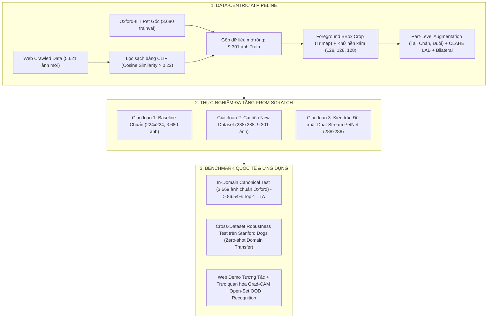

# Oxford-IIIT Pet Classifier from Scratch (Data-Centric & Dual-Stream Architecture)

> **Đề Tài:** Nghiên Cứu và Phân Loại 37 Giống Chó Mèo với Kỹ Thuật Tăng Cường Dữ Liệu Bộ Phận (Part-Level Augmentation) và Kiến Trúc Đa Luồng Đề Xuất (Dual-Stream Siamese PetNet)  
> **Phương Thức Huấn Luyện:** 100% Từ Đầu (**Pure From Scratch** - Khởi tạo Kaiming He Normal, không sử dụng Pre-trained Weights)  
> **Nền Tảng:** PyTorch  

---

## 👥 Thành Viên Nhóm Thực Hiện

| Ký hiệu | Thành viên | Vai trò & Mô hình phụ trách |
| :---: | :--- | :--- |
| **HL** | **Nguyễn Hữu Hoàng Luân** | Trưởng nhóm, phát triển Kiến trúc Đề xuất **Dual-Stream EfficientNet-B0**, **EfficientNet-B0** (Baseline & New Dataset), Pipeline lọc dữ liệu mở rộng bằng CLIP, Hệ sinh thái Web Demo & Grad-CAM |
| **AL** | **Mai Anh Luân** | Nghiên cứu và thực nghiệm **SEResNet-18** (Channel Attention - Baseline & New Dataset), **ResNet-18** (Dataset chuẩn) |
| **LP** | **Hoàng Lương Phước** | Nghiên cứu và thực nghiệm **DenseNet-121** (Dense Connectivity - Baseline & New Dataset), **ResNet-18** (New Dataset) |

---

## 🌟 Tóm Tắt Đóng Góp Kỹ Thuật Nổi Bật



1. **Phương pháp Data-Centric AI & Mở rộng Dữ liệu:**
   * **Mở rộng tập Train lên 9.301 ảnh:** Thu thập bổ sung 5.621 ảnh chất lượng cao và sử dụng mô hình đa phương thức **CLIP** để thẩm định nhãn tự động (ngưỡng Cosine Similarity $> 0.22$), bảo đảm triệt tiêu nhãn nhiễu.
   * **Bảo toàn tập Test chuẩn (Zero-Leakage):** Giữ nguyên vẹn đúng **3.669 ảnh Canonical Test** gốc của Oxford-IIIT Pet để đối sánh sòng phẳng với các công bố khoa học thế giới.
   * **Tiền xử lý khử nhiễu nền:** Trích xuất Bounding Box tiền cảnh (Foreground Crop) và trung hòa phông nền thành màu xám `(128, 128, 128)` dựa trên mặt nạ Trimap.
   * **Tăng cường cấp độ bộ phận (Part-Level Augmentation):** Cắt ngẫu nhiên từ 8% đến 40% diện tích (tai, chân, đuôi, thân), ép mô hình học đặc trưng cục bộ; kết hợp bộ lọc **CLAHE LAB** (kênh L) và **Bilateral Filtering** tăng cường chi tiết sợi lông.
2. **Kiến Trúc Đề Xuất Đột Phá — Dual-Stream Siamese PetNet:**
   * **Thiết kế 2 luồng song song:** Luồng 1 (Toàn thân thú cưng - Body Stream) kết hợp Luồng 2 (Cận cảnh khuôn mặt/tai - Head Stream).
   * **Siamese Shared-Backbone (EfficientNet-B0):** Chia sẻ trọng số MBConv giúp giảm 50% tham số (tổng tham số chỉ **5.08M** thay vì >8M).
   * **Gated Cross-Stream Fusion:** Cơ chế cổng đóng mở thích ứng hòa trộn vector đặc trưng $f_{\text{body}}$ và $f_{\text{head}}$ theo từng mẫu ảnh.
   * **Hiệu năng dẫn đầu:** Đạt **85.72% (Raw Single-View)** và **86.54% (4-View TTA)** hoàn toàn From Scratch.
3. **Thực Nghiệm Bóc Tách (Ablation Study) Khách Quan:**
   * Đối sánh công bằng giữa các kiến trúc kinh điển (**ResNet-18, SEResNet-18, DenseNet-121, EfficientNet-B0**) trên cả 2 giai đoạn: Dataset chuẩn ($224 \times 224$) và Dataset mới ($288 \times 288$).
4. **Kiểm Thử Khả Năng Tổng Quát Hóa (Cross-Dataset trên Stanford Dogs):**
   * Đánh giá Zero-shot (không huấn luyện lại) trên các giống chó giao nhau của Stanford Dogs, chứng minh mô hình học đúng hình thái sinh học chứ không học vẹt bối cảnh.
5. **Hệ Sinh Thái Ứng Dụng (Web Demo & Grad-CAM & Open-Set OOD):**
   * Giao diện Web tương tác hiển thị Top-5 giống có độ tin cậy cao nhất, phủ bản đồ nhiệt Grad-CAM giải thích quyết định của mạng, và tích hợp bộ lọc Entropy/Energy tự động phát hiện các giống ngoài danh mục.

---

## 📁 Cấu Trúc Dự Án (Repository Structure)

```text
ml-semester-cat-dog-classifier/
├── README.md
├── .gitignore
├── dataset/
│   ├── oxford-iiit-pet/                 <-- Dataset chuẩn gốc (3.680 trainval / 3.669 test)
│   │   ├── annotations/
│   │   └── images/
│   ├── new_dataset/                     <-- Tập dữ liệu mở rộng (5.621 ảnh đã lọc sạch bằng CLIP)
│   │   ├── annotations/
│   │   └── images/
│   └── new_dataset.zip                  <-- Bản nén phục vụ upload Kaggle
│
├── src/                                 <-- Mã nguồn cốt lõi của dự án
│   ├── __init__.py
│   ├── dataset.py                       <-- Dataset Loader, BBox Crop, Trimap Mask, CLAHE, Bilateral
│   ├── models.py                        <-- 11 Kiến trúc CNN & Transformer viết thuần PyTorch From Scratch
│   ├── train.py                         <-- Engine huấn luyện, quản lý Checkpoint, Scheduler, Resume
│   ├── build_augmented_dataset.py       <-- Script tạo tập dữ liệu mở rộng
│   ├── verify_breed_clip.py             <-- Script dùng CLIP thẩm định và lọc nhãn ảnh cào từ web
│   ├── clean_and_balance_dataset.py     <-- Làm sạch và cân bằng số lượng ảnh giữa các giống
│   └── finish_balancing_clip.py         <-- Hoàn thiện cân bằng dữ liệu bằng CLIP Cosine Filtering
│
├── notebooks/                           <-- Toàn bộ hệ thống Notebook chia theo Dataset & Thành viên
│   │
│   ├── Original Dataset/                <-- Giai đoạn 1: Huấn luyện trên 3.680 ảnh Oxford gốc (224x224)
│   │   ├── Resnet18_AL/                 <-- Mai Anh Luân phụ trách ResNet-18 (Standard)
│   │   │   ├── resnet18.ipynb
│   │   │   ├── checkpoints/
│   │   │   └── plots/
│   │   ├── Seresnet18_AL/               <-- Mai Anh Luân phụ trách SEResNet-18 (Standard)
│   │   │   ├── seresnet18_foreground.ipynb
│   │   │   ├── checkpoints/
│   │   │   └── plots/
│   │   ├── Efficientnet_HL/             <-- Nguyễn Hữu Hoàng Luân phụ trách EfficientNet-B0 (Standard)
│   │   │   ├── fg10-efficientnet.ipynb
│   │   │   ├── checkpoints/
│   │   │   └── plots/
│   │   └── Densenet121_LP/              <-- Hoàng Lương Phước phụ trách DenseNet-121 (Standard)
│   │       ├── 06_densenet121.ipynb
│   │       ├── checkpoints/
│   │       └── plots/
│   │
│   ├── New Dataset /                    <-- Giai đoạn 2: Huấn luyện trên 9.301 ảnh Mở Rộng (288x288)
│   │   ├── Dual_stream_efficientnet_HL/ <-- MÔ HÌNH ĐỀ XUẤT TỐI ƯU NHẤT (Nguyễn Hữu Hoàng Luân)
│   │   │   ├── fg16-dual-stream-efficientnet.ipynb
│   │   │   ├── checkpoints/             <-- dual_stream_efficientnet_best.pth (86.54% TTA)
│   │   │   └── plots/                   <-- Curves, Confusion Matrix 37x37, dual_stream_metrics.json
│   │   ├── Efficientnet_HL/             <-- Nguyễn Hữu Hoàng Luân phụ trách EfficientNet-B0 (New Dataset)
│   │   │   ├── fg15-efficientnet-new-dataset.ipynb
│   │   │   ├── checkpoints/
│   │   │   └── plots/
│   │   ├── Seresnet18_AL/               <-- Mai Anh Luân phụ trách SEResNet-18 (New Dataset)
│   │   │   ├── fg-seresnet18-newdataset-al.ipynb
│   │   │   ├── checkpoints/
│   │   │   └── plots/
│   │   ├── Resnet18_LP/                 <-- Hoàng Lương Phước phụ trách ResNet-18 (New Dataset)
│   │   │   ├── resnet18-new.ipynb
│   │   │   ├── checkpoints/
│   │   │   └── plots/
│   │   └── DenseNet121_LP/              <-- Hoàng Lương Phước phụ trách DenseNet-121 (New Dataset)
│   │       ├── 06_densenet121_new_dataset (1).ipynb
│   │       ├── checkpoints/
│   │       └── plots/
│   │
│   └── reference/                       <-- Các mô hình CNN chuẩn kinh điển dùng để tham chiếu
│       ├── 01_custom_cnn/
│       ├── 02_alexnet/
│       ├── 03_vgg11_bn/
│       ├── 04_resnet18/
│       ├── 05_resnet34/
│       ├── 07_mobilenet_v2/
│       ├── 09_resnet50/
│       └── 11_clip/
│
└── report/                              <-- Tài liệu báo cáo hoàn chỉnh & Bảng đối sánh
    ├── bao_cao_cai_tien_toan_dien.md    <-- Báo cáo khoa học chi tiết 6 mục chuẩn bị cho nghiệm thu
    └── model_benchmark_report.md        <-- Báo cáo đối sánh các mô hình baseline
```

---

## 📊 Bảng Đối Sánh Benchmark Tổng Hợp

> **Quy chuẩn đánh giá:** Toàn bộ các mô hình bên dưới đều được kiểm định trên cùng tập **Canonical Test gồm đúng 3.669 ảnh** của tác giả gốc (*Parkhi et al., CVPR 2012*). Không rò rỉ dữ liệu test vào bất kỳ khâu huấn luyện nào.

| Nhóm thực nghiệm | Phương pháp / Mô hình | Phụ trách | Kích thước | Tập huấn luyện | #Params | Top-1 Acc (Raw) | Top-1 Acc (4-View TTA) |
| :--- | :--- | :---: | :---: | :---: | :---: | :---: | :---: |
| **Công bố quốc tế** | *SIFT + Spatial Pyramid* (Parkhi 2012) | CVPR 2012 | — | Oxford (3.680) | — | 59.20% | — |
| **Tham chiếu Baseline** | Custom CNN (6 tầng) | Reference | $224 \times 224$ | Oxford (3.680) | 0.43M | 15.04% | — |
| | AlexNet (Batch Normalization) | Reference | $224 \times 224$ | Oxford (3.680) | 23.4M | 28.18% | — |
| | MobileNetV2 | Reference | $224 \times 224$ | Oxford (3.680) | 2.27M | 34.26% | — |
| | VGG-11 (Batch Normalization) | Reference | $224 \times 224$ | Oxford (3.680) | 128.9M | 2.73% *(Bão hòa)* | — |
| | ResNet-34 | Reference | $224 \times 224$ | Oxford (3.680) | 21.3M | 39.22% | — |
| | ResNet-50 | Reference | $224 \times 224$ | Oxford (3.680) | 23.6M | 40.96% | — |
| **Giai đoạn 1 (Baseline)** | **ResNet-18** | **AL** | $224 \times 224$ | Oxford (3.680) | 11.20M | 38.57% | — |
| | **DenseNet-121** | **LP** | $224 \times 224$ | Oxford (3.680) | 6.99M | 40.31% | — |
| | **SEResNet-18** *(SE Attention)* | **AL** | $224 \times 224$ | Oxford (3.680) | 11.26M | 42.44% | — |
| | **EfficientNet-B0** | **HL** | $224 \times 224$ | Oxford (3.680) | 4.05M | **74.19%** | **75.28%** |
| **Giai đoạn 2 (New Dataset)**| **ResNet-18 (Mở rộng)** | **LP** | $288 \times 288$ | Expanded (9.301)| 11.20M | *Đang cập nhật* | *Đang cập nhật* |
| | **DenseNet-121 (Mở rộng)** | **LP** | $288 \times 288$ | Expanded (9.301)| 6.99M | *Đang cập nhật* | *Đang cập nhật* |
| | **SEResNet-18 (Mở rộng)** | **AL** | $288 \times 288$ | Expanded (9.301)| 11.26M | *Đang cập nhật* | *Đang cập nhật* |
| | **EfficientNet-B0 (Mở rộng)** | **HL** | $288 \times 288$ | Expanded (9.301)| 4.05M | **83.32%** | **83.78%** |
| **ĐỀ XUẤT TỐI ƯU NHẤT** | **Dual-Stream Siamese PetNet** | **HL** | **$288 \times 288$** | **Expanded (9.301)** | **5.08M** | **85.72%** | **86.54%** |
| *Tham chiếu Pretrained* | *ResNet-50 (ImageNet-1K Pretrained)* | Reference | $224 \times 224$ | Pretrained 1.28M | 23.6M | ~93.50% | — |
| *Tham chiếu Pretrained* | *EfficientNet-B0 (ImageNet-1K Pretrained)* | Reference | $224 \times 224$ | Pretrained 1.28M | 4.05M | ~94.50% | — |

---

## 🏗️ Kiến Trúc Đề Xuất: Dual-Stream Siamese PetNet

```text
                                  Ảnh Gốc Thú Cưng
                                         │
                    ┌────────────────────┴────────────────────┐
                    ▼                                         ▼
         ┌─────────────────────┐                   ┌─────────────────────┐
         │   Body Stream Crop  │                   │   Head Stream Crop  │
         │   (Tensor 288x288)  │                   │   (Tensor 288x288)  │
         │ • Toàn thân thú cưng│                   │ • Cận cảnh mặt/tai  │
         │ • Khử nền bằng xám  │                   │ • Trích xuất BBox   │
         └──────────┬──────────┘                   └──────────┬──────────┘
                    │                                         │
                    ▼                                         ▼
         ┌───────────────────────────────────────────────────────────────┐
         │            Siamese Shared Backbone: EfficientNet-B0           │
         │     (Chia sẻ trọng số MBConv - Tiết kiệm 50% số tham số)      │
         └──────────────────────────┬─────────────────────────┬──────────┘
                                    │                         │
                                    ▼                         ▼
                         Vector f_body (1280d)     Vector f_head (1280d)
                                    │                         │
                                    └────────────┬────────────┘
                                                 │
                                                 ▼
         ┌───────────────────────────────────────────────────────────────┐
         │                 Gated Cross-Stream Fusion Neck                │
         │  1. Ghép nối: f_concat = [f_body ; f_head] (2560d)            │
         │  2. Trọng số cổng: g = Sigmoid(Linear(f_concat)) (1280d)      │
         │  3. Hòa trộn: f_fused = g * f_head + (1 - g) * f_body         │
         └───────────────────────────────┬───────────────────────────────┘
                                         │
                                         ▼
                              Layer Normalization (1280d)
                                         │
                                         ▼
                               Linear Classifier (1280 -> 37)
                                         │
                                         ▼
                         Xác Suất Dự Đoán 37 Giống Loài (Softmax)
```

---

## 🚀 Hướng Dẫn Tái Lập & Chạy Thực Nghiệm

### 1. Chạy trên Kaggle / Google Colab (Khuyến nghị)
Mọi notebook trong thư mục `notebooks/` đều được tích hợp sẵn cơ chế **Kaggle Automation**:
* Tự động clone repository từ GitHub.
* Tự động định vị thư mục làm việc (`os.chdir`).
* Tự động quét và nạp dữ liệu từ `/kaggle/input` hoặc tự động tải New Dataset qua `kagglehub` (`nguyenhuuhoangluan/oxford-pet-new-dataset`).
* Tự động tìm kiếm checkpoint cũ để tiếp tục huấn luyện (Resume) nếu bị ngắt phiên.

**Các bước chạy trên Kaggle:**
1. Tạo một Notebook mới trên Kaggle (chọn GPU T4 x2 hoặc GPU P100).
2. Tải và upload notebook tương ứng (ví dụ: [fg16-dual-stream-efficientnet.ipynb](notebooks/New%20Dataset%20/Dual_stream_efficientnet_HL/fg16-dual-stream-efficientnet.ipynb)).
3. Bấm **Run All**. Toàn bộ quá trình chuẩn bị môi trường, tải dữ liệu, huấn luyện và xuất đồ thị sẽ được thực thi hoàn toàn tự động.

### 2. Chạy trên máy cục bộ (Local Environment)

#### Bước 1: Cài đặt môi trường
```bash
git clone https://github.com/LuanNguyen23T/ml-semester-cat-dog-classifier.git
cd ml-semester-cat-dog-classifier
pip install torch torchvision numpy scikit-learn matplotlib pillow opencv-python
```

#### Bước 2: Huấn luyện qua dòng lệnh (CLI)
```bash
# Huấn luyện ResNet-18 Baseline (Dataset chuẩn)
python3 src/train.py --model resnet18 --task breed --img_size 224 --batch_size 64 --epochs 100

# Huấn luyện EfficientNet-B0 (Tập mở rộng 288x288)
python3 src/train.py --model efficientnet --task breed --img_size 288 --batch_size 48 --epochs 100
```

#### Bước 3: Đánh giá trích xuất chỉ số (Top-1, Top-5, GFLOPs, Macro-F1)
Chạy trực tiếp Cell 13 trong từng notebook để xuất ma trận nhầm lẫn chuẩn hóa $37 \times 37$ và file tóm tắt chỉ số định lượng `*_metrics.json` vào thư mục `./plots/`.

---

## 📑 Tài Liệu Tham Khảo Cốt Lõi

1. **Parkhi et al.**, *"Cats and Dogs"*, IEEE Conference on Computer Vision and Pattern Recognition (CVPR), 2012.
2. **He et al.**, *"Deep Residual Learning for Image Recognition"*, CVPR, 2016.
3. **Huang et al.**, *"Densely Connected Convolutional Networks"*, CVPR, 2017.
4. **Hu et al.**, *"Squeeze-and-Excitation Networks"*, CVPR, 2018 (Best Paper Award).
5. **Tan & Le**, *"EfficientNet: Rethinking Model Scaling for Convolutional Neural Networks"*, ICML, 2019.
6. **Hendrycks & Dietterich**, *"Benchmarking Neural Network Robustness to Common Corruptions and Perturbations"*, ICLR, 2019.
7. **Radford et al.**, *"Learning Transferable Visual Models From Natural Language Supervision (CLIP)"*, ICML, 2021.
