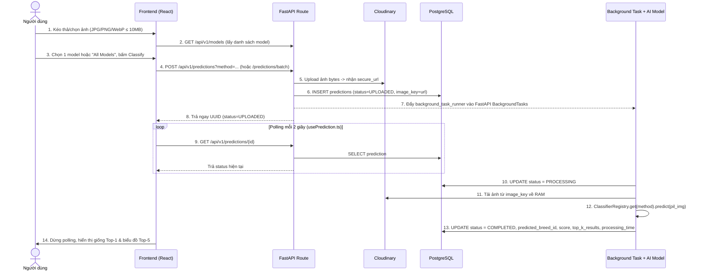

# Báo Cáo Khảo Sát & Kế Hoạch Chuyển Đổi Mô Hình (`AUDIT.md`)

Tài liệu này tổng hợp kết quả đọc hiểu toàn bộ codebase hiện tại (dự án gốc dùng CLIP & ResNet-50 pretrained) và đối chiếu với 5 mô hình mới tự huấn luyện trong `my_training/` (`ResNet18`, `SEResNet18`, `DenseNet121`, `EfficientNet-B0`, và mô hình đề xuất chính `Dual-Stream EfficientNet-B0`).

---

## 1. Tổng Quan Kiến Trúc, Luồng Chạy & Cơ Sở Dữ Liệu

### 1.1. Dự án khởi chạy và vận hành như thế nào?

Hệ thống là một ứng dụng web nhận diện 37 giống chó mèo (theo bộ nhãn Oxford-IIIT Pet) theo mô hình **Client – Server kết hợp xử lý bất đồng bộ (Background Task)**, gồm 4 thành phần chính:

1. **PostgreSQL 16 (Database)** — định nghĩa tại [docker-compose.yml](file:///Users/admin/Developer/Machine%20Learning/CLIP-Animal-Classifier/docker-compose.yml):
   - Chạy qua Docker (`postgres:16`), container tên `pet_classifier_db`, database `pet_classifier`, tài khoản `admin` / `secret`, mở cổng `5432`.
2. **Backend API (FastAPI + PyTorch)** — cấu hình tại [SETUP.md](file:///Users/admin/Developer/Machine%20Learning/CLIP-Animal-Classifier/SETUP.md), [backend/requirements.txt](file:///Users/admin/Developer/Machine%20Learning/CLIP-Animal-Classifier/backend/requirements.txt), [backend/app/main.py](file:///Users/admin/Developer/Machine%20Learning/CLIP-Animal-Classifier/backend/app/main.py):
   - Chạy bằng `uvicorn app.main:app --reload --port 8000` trong môi trường `backend/.venv`.
   - Cấu hình đọc từ `backend/.env` qua [backend/app/core/config.py](file:///Users/admin/Developer/Machine%20Learning/CLIP-Animal-Classifier/backend/app/core/config.py) (thông số PostgreSQL, Cloudinary, và `AI_DEVICE=auto|cpu|mps|cuda` ưu tiên Apple Silicon MPS nếu có).
   - Tạo bảng bằng `alembic upgrade head` và nạp dữ liệu giống loài bằng [scripts/seed_breeds.py](file:///Users/admin/Developer/Machine%20Learning/CLIP-Animal-Classifier/scripts/seed_breeds.py).
   - *(Lưu ý kỹ thuật phát hiện khi đọc)*: [SETUP.md](file:///Users/admin/Developer/Machine%20Learning/CLIP-Animal-Classifier/SETUP.md#L46) có nhắc lệnh `python scripts/export_weights.py` nhưng file thực tế trong `scripts/` là `export_clip_weights.py` và `export_resnet50_weights.py`. Ngoài ra [scripts/seed_breeds.py](file:///Users/admin/Developer/Machine%20Learning/CLIP-Animal-Classifier/scripts/seed_breeds.py#L34) đang đọc file `../dataset/oxford-iiit-pet/annotations/list.txt`, nhưng thư mục `dataset/oxford-iiit-pet/` hiện chưa tồn tại trên ổ đĩa.
3. **Frontend (React 19 + TypeScript + Vite + Tailwind)** — định nghĩa tại [frontend/package.json](file:///Users/admin/Developer/Machine%20Learning/CLIP-Animal-Classifier/frontend/package.json), [frontend/vite.config.ts](file:///Users/admin/Developer/Machine%20Learning/CLIP-Animal-Classifier/frontend/vite.config.ts):
   - Chạy `npm run dev` tại `http://localhost:5173`.
   - Vite proxy mọi đường dẫn `/api/*` sang `http://localhost:8000` (backend cũng cấu hình CORS cho `localhost:5173` và `localhost:3000`).
4. **Cloudinary (Lưu trữ ảnh đám mây)** — [backend/app/storage/cloudinary_storage.py](file:///Users/admin/Developer/Machine%20Learning/CLIP-Animal-Classifier/backend/app/storage/cloudinary_storage.py):
   - Ảnh người dùng upload không lưu trên ổ đĩa local của server mà được đẩy thẳng lên Cloudinary (thư mục `clip-pet-classifier/users/anonymous`), lấy lại `secure_url` để lưu vào DB và tải xuống khi chạy suy luận.

---

### 1.2. Luồng một request nhận diện đi từ Giao diện → Backend → Model → Database

Chi tiết từng bước trong code:

1. **Chọn ảnh & cấu hình trên UI**:
   - [ImageUploader](file:///Users/admin/Developer/Machine%20Learning/CLIP-Animal-Classifier/frontend/src/components/ImageUploader/index.tsx) kiểm tra định dạng (`image/jpeg`, `image/png`, `image/webp`) và dung lượng (≤ 10MB).
   - [HomePage](file:///Users/admin/Developer/Machine%20Learning/CLIP-Animal-Classifier/frontend/src/pages/Home/index.tsx) chuyển sang bước `CONFIG`, hiển thị [ConfigPanel](file:///Users/admin/Developer/Machine%20Learning/CLIP-Animal-Classifier/frontend/src/components/ConfigPanel/index.tsx). Component này gọi `GET /api/v1/models` ([backend/app/api/routes/models.py](file:///Users/admin/Developer/Machine%20Learning/CLIP-Animal-Classifier/backend/app/api/routes/models.py)) để lấy metadata model từ `ClassifierRegistry.list_models()`.
2. **Gửi request tạo dự đoán**:
   - [predictionApi.ts](file:///Users/admin/Developer/Machine%20Learning/CLIP-Animal-Classifier/frontend/src/services/predictionApi.ts) gọi `POST /api/v1/predictions?method=<method>` (1 model) hoặc `POST /api/v1/predictions/batch` (tất cả model).
   - Tại [backend/app/api/routes/predictions.py](file:///Users/admin/Developer/Machine%20Learning/CLIP-Animal-Classifier/backend/app/api/routes/predictions.py): route kiểm tra `content_type.startswith("image/")`, upload bytes lên Cloudinary, lưu bản ghi vào bảng `predictions` (với chế độ batch, tất cả bản ghi dùng chung một `batch_id` UUID và cùng một `image_key`), rồi đưa `background_task_runner` vào `BackgroundTasks` và trả về HTTP response ngay để trình duyệt không bị treo.
3. **Frontend Polling**:
   - [usePrediction.ts](file:///Users/admin/Developer/Machine%20Learning/CLIP-Animal-Classifier/frontend/src/hooks/usePrediction.ts) lưu các `id` vào `localStorage` (`pet-classifier:prediction-ids`, giúp F5 không mất kết quả đang chạy) và gọi `GET /api/v1/predictions/{id}` mỗi `2000ms` cho đến khi mọi bản ghi chuyển sang `COMPLETED` hoặc `FAILED`.
4. **Thực thi Model AI ở nền**:
   - `background_task_runner` ([predictions.py](file:///Users/admin/Developer/Machine%20Learning/CLIP-Animal-Classifier/backend/app/api/routes/predictions.py#L82-L90)) mở một DB session mới (`SessionLocal()`), lấy classifier từ `ClassifierRegistry.get(ModelMethod(method))` ([registry.py](file:///Users/admin/Developer/Machine%20Learning/CLIP-Animal-Classifier/backend/app/ai/registry.py) — singleton lazy-load, chỉ nạp weights vào RAM/GPU ở lần gọi đầu tiên).
   - [run_inference_task](file:///Users/admin/Developer/Machine%20Learning/CLIP-Animal-Classifier/backend/app/services/prediction.py#L8-L68) cập nhật `status=PROCESSING`, tải ảnh từ Cloudinary URL bằng `urllib.request`, chuyển thành `PIL.Image` mode `"RGB"`, gọi `classifier.predict(pil_img)` và đo `processing_time`.
   - Kết quả `ClassifierResult` ([base.py](file:///Users/admin/Developer/Machine%20Learning/CLIP-Animal-Classifier/backend/app/ai/base.py)) gồm `predicted_breed_id` (1..37), `score`, `top_k_results` (Top-5), `model_version` được ghi lại vào PostgreSQL với `status=COMPLETED` (hoặc `FAILED` + `error_message` nếu có ngoại lệ).
5. **Xem lịch sử & thống kê**:
   - Trang [History](file:///Users/admin/Developer/Machine%20Learning/CLIP-Animal-Classifier/frontend/src/pages/History/index.tsx) gọi `GET /api/v1/prediction-history` (gom nhóm theo `COALESCE(batch_id, id)`).
   - Trang [Statistics](file:///Users/admin/Developer/Machine%20Learning/CLIP-Animal-Classifier/frontend/src/pages/Statistics/index.tsx) gọi `GET /api/v1/statistics` ([statistics.py](file:///Users/admin/Developer/Machine%20Learning/CLIP-Animal-Classifier/backend/app/api/routes/statistics.py)).

---

### 1.3. Cơ sở dữ liệu hiện có những bảng nào?

Theo `backend/app/models/` và 4 file migration trong `backend/alembic/versions/`, database PostgreSQL hiện có **3 bảng nghiệp vụ** (và 1 bảng `alembic_version` do Alembic tự tạo):

1. **Bảng `species`** ([backend/app/models/species.py](file:///Users/admin/Developer/Machine%20Learning/CLIP-Animal-Classifier/backend/app/models/species.py))
   - `id`: `Integer`, Primary Key
   - `name`: `String`, Unique, Index (`"Cat"` với `id=1`, `"Dog"` với `id=2`)

2. **Bảng `breeds`** ([backend/app/models/breed.py](file:///Users/admin/Developer/Machine%20Learning/CLIP-Animal-Classifier/backend/app/models/breed.py))
   - `id`: `Integer`, Primary Key (`1..37`, trùng khớp thứ tự 37 lớp của Oxford-IIIT Pet)
   - `name`: `String`, Unique, Index (ví dụ `"Abyssinian"`, `"american_bulldog"`, ...)
   - `species_id`: `Integer`, Foreign Key → `species.id`

3. **Bảng `predictions`** ([backend/app/models/prediction.py](file:///Users/admin/Developer/Machine%20Learning/CLIP-Animal-Classifier/backend/app/models/prediction.py))
   - `id`: `UUID`, Primary Key
   - `batch_id`: `UUID`, Nullable, Index *(thêm bởi migration `41f07e7fdc21`)* — gom các lần chạy khi chọn "All Models"
   - `image_key`: `String`, Not Null — lưu Cloudinary `secure_url`
   - `predicted_breed_id`: `Integer`, Nullable, Foreign Key → `breeds.id`
   - `score`: `Float`, Nullable — xác suất Top-1 (`0.0` – `1.0`)
   - `top_k_results`: `JSONB`, Nullable — mảng JSON chứa Top-5 `{breed_id, breed_name, species, score}`
   - `model_version`: `String`, Nullable — chuỗi định danh phiên bản model
   - `method`: `String`, Nullable *(thêm bởi migration `c692c384f31c`)* — giá trị `ModelMethod` (ví dụ `"zero-shot"`, `"coop"`, ...)
   - `processing_time`: `Float`, Nullable *(thêm bởi migration `9c6dba231b24`)* — thời gian chạy inference (giây)
   - `status`: `Enum('UPLOADED', 'PROCESSING', 'COMPLETED', 'FAILED')` (kiểu PG `predictionstatus`), Not Null
   - `error_message`: `Text`, Nullable
   - `created_at`: `DateTime`, mặc định `datetime.utcnow`

**Lịch sử 4 Alembic migrations**:
- `12fc01494473_initial_tables.py`: tạo `species`, `breeds`, `predictions`.
- `c692c384f31c_add_method_column_to_predictions.py`: thêm cột `method`.
- `9c6dba231b24_add_processing_time_to_predictions.py`: thêm cột `processing_time`.
- `41f07e7fdc21_add_batch_id_to_predictions.py`: thêm cột `batch_id` + backfill cho các request batch cũ.

> [!NOTE]
> Schema Database (`species`, `breeds`, `predictions`) là **độc lập với kiến trúc AI**. Cột `method` và `model_version` là `String` tự do (không phải PostgreSQL Enum), nên khi thay 5 model mới **không bắt buộc phải sửa schema database hay chạy migration mới**, trừ khi bạn muốn thêm metadata riêng (ví dụ ảnh đầu đã crop hoặc thông tin dùng/không dùng TTA).

---

## 2. Các Điểm Trong Code Đang Gọi CLIP, Zero-Shot, Linear Probe, Tip-Adapter (và ResNet-50 Cũ)

Dưới đây là danh sách chính xác các vị trí cần thay thế hoặc gỡ bỏ khi chuyển sang 5 model của bạn:

### 2.1. Backend — Tầng AI & Xử lý ảnh

| File | Dòng / Thành phần | Đang dùng gì | Ghi chú khi thay |
| :--- | :--- | :--- | :--- |
| [shared_backbone.py](file:///Users/admin/Developer/Machine%20Learning/CLIP-Animal-Classifier/backend/app/ai/shared_backbone.py) | Toàn bộ file (`CLIPModel`, `CLIPProcessor`, `openai/clip-vit-base-patch32`, `text_features_enr.pt`, `clip_benchmark_manifest.json`) | Tải CLIP backbone từ HuggingFace & kiểm tra hash artifacts CLIP | **Quan trọng**: File này cũng đang chứa `BREED_CATALOGUE` (lines 45–83) và `get_device()` (lines 130–151). Cần tách 2 phần này ra module dùng chung trước khi xoá phần CLIP. |
| [clip_zero_shot.py](file:///Users/admin/Developer/Machine%20Learning/CLIP-Animal-Classifier/backend/app/ai/clip_zero_shot.py) | `ZeroShotClassifier` | CLIP Zero-Shot + 5-view TTA | Thay thế / gỡ bỏ |
| [tip_adapter.py](file:///Users/admin/Developer/Machine%20Learning/CLIP-Animal-Classifier/backend/app/ai/tip_adapter.py) | `TipAdapterClassifier` | CLIP Tip-Adapter (Training-Free Cache `tip_adapter_cache.pt`) | Thay thế / gỡ bỏ |
| [tip_adapter_f.py](file:///Users/admin/Developer/Machine%20Learning/CLIP-Animal-Classifier/backend/app/ai/tip_adapter_f.py) | `TipAdapterFClassifier`, `_TipAdapterF` | CLIP Tip-Adapter-F (`tip_adapter_f_full.pt`) | Thay thế / gỡ bỏ |
| [clip_adapter.py](file:///Users/admin/Developer/Machine%20Learning/CLIP-Animal-Classifier/backend/app/ai/clip_adapter.py) | `CLIPAdapterClassifier`, `_CLIPAdapter` | CLIP-Adapter (`clip_adapter_full.pt`) | Thay thế / gỡ bỏ |
| [coop.py](file:///Users/admin/Developer/Machine%20Learning/CLIP-Animal-Classifier/backend/app/ai/coop.py) | `CoOpClassifier` | CLIP CoOp Prompt Tuning (`coop_context_full.pt`, monkey-patch token embedding) | Thay thế / gỡ bỏ |
| [shared_resnet_backbone.py](file:///Users/admin/Developer/Machine%20Learning/CLIP-Animal-Classifier/backend/app/ai/shared_resnet_backbone.py) | `get_resnet50_backbone` | ResNet-50 pretrained ImageNet (`torchvision.models`) | Thay thế / gỡ bỏ cùng bộ 5 ResNet-50 cũ |
| [resnet50_baseline.py](file:///Users/admin/Developer/Machine%20Learning/CLIP-Animal-Classifier/backend/app/ai/resnet50_baseline.py) | `ResNet50BaselineClassifier` | ResNet-50 Baseline (Linear Probe trên ảnh raw, `resnet50_baseline.pt`) | Thay thế / gỡ bỏ |
| [resnet50_linear.py](file:///Users/admin/Developer/Machine%20Learning/CLIP-Animal-Classifier/backend/app/ai/resnet50_linear.py) | `ResNet50LinearClassifier` | ResNet-50 Linear Probe (TTA 5-view, `resnet50_linear.pt`) | Thay thế / gỡ bỏ |
| [resnet50_prototype.py](file:///Users/admin/Developer/Machine%20Learning/CLIP-Animal-Classifier/backend/app/ai/resnet50_prototype.py) | `ResNet50PrototypeClassifier` | ResNet-50 Prototype (`resnet50_prototype.pt`) | Thay thế / gỡ bỏ |
| [resnet50_adapter.py](file:///Users/admin/Developer/Machine%20Learning/CLIP-Animal-Classifier/backend/app/ai/resnet50_adapter.py) | `ResNet50AdapterClassifier` | ResNet-50 Residual Adapter (`resnet50_adapter.pt`) | Thay thế / gỡ bỏ |
| [resnet50_cosine.py](file:///Users/admin/Developer/Machine%20Learning/CLIP-Animal-Classifier/backend/app/ai/resnet50_cosine.py) | `ResNet50CosineClassifier` | ResNet-50 Cosine Head (`resnet50_cosine_full.pt`) | Thay thế / gỡ bỏ |
| [registry.py](file:///Users/admin/Developer/Machine%20Learning/CLIP-Animal-Classifier/backend/app/ai/registry.py) | `ModelMethod` (lines 19–29), `MODEL_DISPLAY_INFO` (lines 33–124), `ClassifierRegistry._load` (lines 144–185) | Đăng ký 5 CLIP methods + 5 ResNet-50 methods | Thay bằng 5 enum & metadata mới (`resnet18`, `seresnet18`, `densenet121`, `efficientnet-b0`, `dual-stream-efficientnet`) |
| [services/image.py](file:///Users/admin/Developer/Machine%20Learning/CLIP-Animal-Classifier/backend/app/services/image.py) | 5 hàm TTA (`get_raw_view`, `get_denoise_view`, `get_clahe_view`, `get_optimal_view`, `get_geom_view`) | 5-view TTA kiểu CLIP (Bilateral + CLAHE + Flip/Rotate 15°) | 5 model mới lúc eval dùng **4-View TTA khác** (Gốc, Flip ngang, Center Zoom 0.9x, Flip+Zoom) và không dùng Bilateral/CLAHE ở test-time |

### 2.2. Backend — Routes, Config, Dependencies

- [backend/app/api/routes/predictions.py](file:///Users/admin/Developer/Machine%20Learning/CLIP-Animal-Classifier/backend/app/api/routes/predictions.py#L27): `method: ModelMethod = ModelMethod.ZERO_SHOT` (cần đổi mặc định sang model chính mới, ví dụ `Dual-Stream EfficientNet-B0`); và lines 129–136 lọc theo `backbone`.
- [backend/app/api/routes/statistics.py](file:///Users/admin/Developer/Machine%20Learning/CLIP-Animal-Classifier/backend/app/api/routes/statistics.py#L48-L55): lọc `backbone` theo `MODEL_DISPLAY_INFO`; và line 111 `.filter(*filters, Prediction.method.in_([item.value for item in ModelMethod]))` — lưu ý nếu xoá enum cũ mà DB còn record cũ thì `by_method` sẽ loại các record đó khỏi biểu đồ `Run reliability`.
- [backend/app/models/prediction.py](file:///Users/admin/Developer/Machine%20Learning/CLIP-Animal-Classifier/backend/app/models/prediction.py#L25): comment tham chiếu `zero-shot | tip-adapter-f | clip-adapter | coop`.
- [backend/app/core/config.py](file:///Users/admin/Developer/Machine%20Learning/CLIP-Animal-Classifier/backend/app/core/config.py#L4) & [backend/app/main.py](file:///Users/admin/Developer/Machine%20Learning/CLIP-Animal-Classifier/backend/app/main.py#L26): chuỗi `"CLIP Pet Classifier"`.
- [backend/app/storage/cloudinary_storage.py](file:///Users/admin/Developer/Machine%20Learning/CLIP-Animal-Classifier/backend/app/storage/cloudinary_storage.py#L14): folder upload `clip-pet-classifier/users/{user_id}`.
- [backend/requirements.txt](file:///Users/admin/Developer/Machine%20Learning/CLIP-Animal-Classifier/backend/requirements.txt#L18): `transformers==5.17.0` (chỉ dùng cho HuggingFace `CLIPModel` / `CLIPProcessor`).

### 2.3. Frontend

- [frontend/src/types/prediction.ts](file:///Users/admin/Developer/Machine%20Learning/CLIP-Animal-Classifier/frontend/src/types/prediction.ts#L4-L7): `BackboneType = 'clip' | 'resnet50'` và union `ModelMethod` gồm các giá trị CLIP/ResNet-50 cũ.
- [frontend/src/services/predictionApi.ts](file:///Users/admin/Developer/Machine%20Learning/CLIP-Animal-Classifier/frontend/src/services/predictionApi.ts#L22): mặc định `method: ModelMethod = 'coop'`.
- [frontend/src/pages/Home/index.tsx](file:///Users/admin/Developer/Machine%20Learning/CLIP-Animal-Classifier/frontend/src/pages/Home/index.tsx#L19): `useState<ModelMethod>('zero-shot')` và đoạn mô tả CLIP/CoOp/Zero-Shot ở line 368.
- [frontend/src/components/ConfigPanel/index.tsx](file:///Users/admin/Developer/Machine%20Learning/CLIP-Animal-Classifier/frontend/src/components/ConfigPanel/index.tsx):
  - Line 31, 41, 87: `activeBackbone` mặc định `'clip'`, fallback `'zero-shot'` / `'resnet50-cosine'`.
  - Lines 16–21: `getModelDisplayName` hardcode badge cho `'coop'` và `'zero-shot'`.
  - Lines 111–189: UI chia 2 tầng **Model Backbone (`CLIP` / `ResNet-50`) → Adapter Method** + fallback `<option>` hardcode `zero-shot`, `tip-adapter`, `tip-adapter-f`, `clip-adapter`, `coop`, `resnet50-*`. (Với 5 model mới độc lập nhau, không cần phân tầng backbone/adapter kiểu cũ mà có thể chọn trực tiếp 1 trong 5 model hoặc nhóm theo Single-Stream / Dual-Stream).
  - Lines 194–223: ô nhập `Custom Prompt Context` chỉ hiện khi `selectedMethod === 'coop'` (thực tế `customPrompt` hiện tại ở `HomePage` cũng chưa được gửi lên backend).
- [frontend/src/pages/History/index.tsx](file:///Users/admin/Developer/Machine%20Learning/CLIP-Animal-Classifier/frontend/src/pages/History/index.tsx#L33): line 33 đoán backbone bằng `method?.startsWith('resnet50-') ? 'resnet50' : 'clip'`; lines 71–72 và line 143 hardcode `<option value="clip">` và `<option value="resnet50">`.
- [frontend/src/pages/Statistics/index.tsx](file:///Users/admin/Developer/Machine%20Learning/CLIP-Animal-Classifier/frontend/src/pages/Statistics/index.tsx#L276-L277): bộ lọc `Model` hardcode `<option value="clip">` và `<option value="resnet50">`.
- [frontend/src/App.tsx](file:///Users/admin/Developer/Machine%20Learning/CLIP-Animal-Classifier/frontend/src/App.tsx#L76) & [frontend/index.html](file:///Users/admin/Developer/Machine%20Learning/CLIP-Animal-Classifier/frontend/index.html#L6-L11): tiêu đề / mô tả `"Powered by CLIP"`.

---

## 3. Phân Tích Chi Tiết 5 Mô Hình Tự Huấn Luyện (`my_training/` & `backend/weights/*.pth`)

Tất cả 5 mô hình đều được huấn luyện **from scratch** trên tập mở rộng gồm **9.301 ảnh** (3.680 ảnh `Oxford-IIIT Pet trainval` + 5.621 ảnh `new_dataset` đã lọc bằng CLIP) và đánh giá trên **3.669 ảnh `Oxford-IIIT Pet test`**.

### 3.1. Bảng thông số kỹ thuật của 5 mô hình

| Tiêu chí | 1. ResNet-18 | 2. SEResNet-18 | 3. DenseNet-121 | 4. EfficientNet-B0 | 5. Dual-Stream EfficientNet-B0 *(Đề xuất chính)* |
| :--- | :--- | :--- | :--- | :--- | :--- |
| **Notebook** | [resnet18-new.ipynb](file:///Users/admin/Developer/Machine%20Learning/CLIP-Animal-Classifier/my_training/notebooks/resnet18-new.ipynb) | [fg-seresnet18-newdataset-al.ipynb](file:///Users/admin/Developer/Machine%20Learning/CLIP-Animal-Classifier/my_training/notebooks/fg-seresnet18-newdataset-al.ipynb) | [06_densenet121_new_dataset (1).ipynb](file:///Users/admin/Developer/Machine%20Learning/CLIP-Animal-Classifier/my_training/notebooks/06_densenet121_new_dataset%20(1).ipynb) | [fg15-efficientnet-new-dataset.ipynb](file:///Users/admin/Developer/Machine%20Learning/CLIP-Animal-Classifier/my_training/notebooks/fg15-efficientnet-new-dataset.ipynb) | [fg16-dual-stream-efficientnet.ipynb](file:///Users/admin/Developer/Machine%20Learning/CLIP-Animal-Classifier/my_training/notebooks/fg16-dual-stream-efficientnet.ipynb) |
| **Tên class trong Notebook** | `CustomResNet18` (dùng `BasicBlock`) | `CustomSEResNet` (dùng `SEResNetBlock`, `SEBlock`) | `CustomDenseNet121` (`_DenseLayer`, `_DenseBlock`, `_Transition`) | `EfficientNetB0` (`MBConv`, `SqueezeExcitation`) | `DualStreamEfficientNet` (`MBConv`, `SqueezeExcitation`) |
| **Khớp `my_training/src/models.py`?** | Khớp `ResNet18` (`strict=True` **OK**) | **KHÔNG KHỚP** (`SEResNet18` dùng `self.fc`, checkpoint dùng `self.linear`) | Khớp `DenseNet121` (`strict=True` **OK**) | Khớp `EfficientNetB0` (`strict=True` **OK**) | **Chưa có** trong `models.py` (`SqueezeExcitation` dùng `bias=True`, khác `models.py`) |
| **Số tham số** | 11,195,493 | 11,282,533 | 6,991,781 | 4,045,605 | 5,042,081 |
| **Kích thước ảnh đầu vào** | `288 × 288 × 3` | `288 × 288 × 3` | `288 × 288 × 3` | `288 × 288 × 3` | 2 luồng `288 × 288 × 3` (Body + Head) |
| **Chuẩn hoá (Normalize)** | ImageNet Z-score: `mean=[0.485, 0.456, 0.406]`, `std=[0.229, 0.224, 0.225]` | Giống cột 1 | Giống cột 1 | Giống cột 1 | Giống cột 1 (cả 2 luồng) |
| **CLAHE / Bilateral** | **Train:** có (`CLAHE` p=0.4 + `Bilateral` p=0.25) **Test/Eval:** **Không** | **Train:** có **Test/Eval:** **Không** | **Train:** có **Test/Eval:** **Không** | **Train:** có **Test/Eval:** **Không** | **Train:** có **Test/Eval:** **Không** |
| **Tách nền & Crop tiền cảnh (Trimap)** | **Có** trên Oxford (`crop_foreground=True`, `remove_background=True`, `bg=(128,128,128)`); **Không** trên `new_dataset` | Giống cột 1 | Giống cột 1 | Giống cột 1 | **Body:** Trimap crop + nền `(128,128,128)` trên Oxford (Không trên `new_dataset`) **Head:** XML BBox +15% padding trên Oxford; fallback crop 65% trên trên `new_dataset` |
| **File `.pth` trong `backend/weights/`** | `resnet18_augmented_best.pth` (128 MB, epoch 95) | `seresnet18_augmented_best.pth` (129 MB, epoch 84) | `densenet121_augmented_best.pth` (81 MB, epoch 93) | `efficientnet_b0_augmented_best.pth` (47 MB, epoch 95) | `dual_stream_efficientnet_best.pth` (58 MB, epoch 93) |
| **Cấu trúc bên trong `.pth`** | **Checkpoint đầy đủ** (`dict` 6 keys) | **Checkpoint đầy đủ** (`dict` 6 keys) | **Checkpoint đầy đủ** (`dict` 6 keys) | **Checkpoint đầy đủ** (`dict` 6 keys) | **Checkpoint đầy đủ** (`dict` 6 keys) |
| **Benchmark Test Acc (Raw / 4-View TTA)** | 67.84% / 68.47% | 70.62% / 71.55% | 74.54% / 75.33% | 83.32% / 83.78% | **85.72% / 86.54%** |

### 3.2. Chi tiết quan trọng đã kiểm chứng trực tiếp trên code & file `.pth`

1. **Cảnh báo mismatch kiến trúc khi load weight**:
   - Đã chạy kiểm chứng `torch.load` + `load_state_dict(..., strict=True)` trên cả 5 file `.pth`:
     - `ResNet18`, `DenseNet121`, `EfficientNetB0` trong [my_training/src/models.py](file:///Users/admin/Developer/Machine%20Learning/CLIP-Animal-Classifier/my_training/src/models.py) load khớp 100% với 3 file `.pth` tương ứng.
     - **`seresnet18_augmented_best.pth` BỊ LỖI** nếu load bằng `SEResNet18` trong `my_training/src/models.py` (thiếu `fc.weight/bias`, thừa `linear.weight/bias`). Khi đưa vào backend **phải dùng đúng class `CustomSEResNet`** từ notebook [fg-seresnet18-newdataset-al.ipynb](file:///Users/admin/Developer/Machine%20Learning/CLIP-Animal-Classifier/my_training/notebooks/fg-seresnet18-newdataset-al.ipynb).
     - **`DualStreamEfficientNet`** chưa có trong `my_training/src/models.py`, chỉ có trong [fg16-dual-stream-efficientnet.ipynb](file:///Users/admin/Developer/Machine%20Learning/CLIP-Animal-Classifier/my_training/notebooks/fg16-dual-stream-efficientnet.ipynb) (lưu ý `SqueezeExcitation` ở đây dùng `bias=True` ở 2 lớp `nn.Linear`, khác với `EfficientNetB0` dùng `bias=False`).
2. **Cấu trúc bên trong cả 5 file `.pth`**:
   - Tất cả 5 file đều là **checkpoint training đầy đủ** (không phải chỉ `state_dict`), gồm đúng 6 keys:
     `['epoch', 'model_state_dict', 'optimizer_state_dict', 'scheduler_state_dict', 'best_acc', 'history']`.
   - Do chứa cả `optimizer_state_dict` (AdamW lưu 2 tensor trạng thái cho mỗi tham số), dung lượng 5 file hiện tại tổng cộng ~443 MB. Khi đưa vào backend, có thể đọc `ckpt["model_state_dict"]`, hoặc trích xuất riêng `model_state_dict` để giảm dung lượng xuống ~1/3 (~148 MB) và load nhanh hơn.
3. **Pipeline tiền xử lý chuẩn lúc suy luận (Inference)**:
   - Theo `get_transforms(img_size=288, is_train=False)` trong [my_training/src/dataset.py](file:///Users/admin/Developer/Machine%20Learning/CLIP-Animal-Classifier/my_training/src/dataset.py#L140-L146):
     `Resize((328, 328))` → `CenterCrop(288)` → `ToTensor()` → `Normalize([0.485, 0.456, 0.406], [0.229, 0.224, 0.225])`.
   - Nếu bật **4-View TTA** như bước đánh giá cuối trong cả 5 notebook: chạy 4 view (View 1: gốc, View 2: lật ngang, View 3: center-crop `0.9` rồi resize `288×288`, View 4: lật ngang + zoom `0.9`) và lấy tổng có trọng số xác suất softmax: `0.40 * p1 + 0.30 * p2 + 0.15 * p3 + 0.15 * p4`.
4. **Thứ tự 37 lớp**:
   - `OxfordPetDataset._load_classes()` ([my_training/src/dataset.py](file:///Users/admin/Developer/Machine%20Learning/CLIP-Animal-Classifier/my_training/src/dataset.py#L195-L215)) sắp theo `class_id` tăng dần (`1..37`), nhãn target là `class_id - 1` (`0..36`).
   - Trong tập Oxford-IIIT Pet chuẩn (`ox_train` và `ox_test` trong cả 5 notebook), thứ tự 37 lớp là **thứ tự bảng chữ cái không phân biệt hoa/thường** (`0: Abyssinian`, `1: american_bulldog`, `2: american_pit_bull_terrier`, ..., `36: yorkshire_terrier`) — **khớp 100%** với `BREED_CATALOGUE` (`id=1..37`) trong `shared_backbone.py` và bảng `breeds` trong PostgreSQL.
   - *(Lưu ý phụ)*: File [my_training/src/build_augmented_dataset.py](file:///Users/admin/Developer/Machine%20Learning/CLIP-Animal-Classifier/my_training/src/build_augmented_dataset.py#L20-L60) có danh sách `OXFORD_CLASSES` xếp 12 mèo trước (1..12) rồi 25 chó sau (13..37). Tuy nhiên, `testset` trong tất cả notebook là `ox_test` (Oxford chuẩn, alphabetical) và đạt tới 86.54%, chứng tỏ `new_dataset` thực tế trên Kaggle đã được đồng bộ hoặc mô hình học đúng theo thứ tự `0..36` của Oxford chuẩn. Dù vậy, khi tích hợp xong nên kiểm tra thực nghiệm trên một vài ảnh mèo & chó mẫu để xác nhận 100% index khớp DB `breeds.id`.

### 3.3. Thay thế bước Trimap (tách nền & cắt tiền cảnh) khi chạy Web + Cách đo độ chính xác

Khi train và test trong notebook, cả 5 model đều dùng `OxfordPetForegroundDataset` trên tập Oxford: đọc file `trimaps/{img_name}.png` (pixel 1 & 3 là tiền cảnh, pixel 2 là nền) để **crop sát bounding box thú cưng (+4% padding)** và **tô nền thành màu xám `(128, 128, 128)`**. Tuy nhiên, ảnh người dùng upload lên web **không có trimap**.

**Các phương án thay thế khả thi cho 4 model single-stream (và luồng Body của Dual-Stream):**

| Phương án | Cách thực hiện khi suy luận | Ưu điểm | Nhược điểm |
| :--- | :--- | :--- | :--- |
| **A. Không tách nền / Không crop** | Đưa thẳng ảnh upload qua `Resize(328) → CenterCrop(288)` | Nhanh nhất (0 ms phụ thêm), không cần thư viện ngoài; lưu ý lúc train có **5.621/9.301 ảnh (~60.4%)** từ `new_dataset` cũng đã train không có trimap (`crop_foreground=False, remove_background=False`) | Nếu ảnh người dùng chụp thú cưng nhỏ ở góc hoặc nền quá rối, độ chính xác có thể giảm so với ảnh Oxford test có trimap |
| **B. Segmentation tự động thay trimap** | Dùng model tách nền nhẹ (vd: `rembg` / U²-Net-p / BiRefNet hoặc `deeplabv3_mobilenet_v3_large` trong `torchvision` lấy lớp `cat`/`dog`) tạo mask → crop bbox (+4% padding) → tô nền `(128, 128, 128)` | Giống nhất với phân phối dữ liệu Oxford lúc train/test | Tốn thêm thời gian xử lý (thường ~30–150 ms trên MPS/CPU), nếu mask cắt nhầm/mất tai hoặc đuôi sẽ ảnh hưởng phân loại |
| **C. Object Detection crop bounding box** | Dùng detector nhẹ (vd: YOLOv8n hoặc `fasterrcnn_mobilenet_v3_large_320_fpn` lọc class `cat`/`dog`) crop bbox thú cưng (+4% padding), **không xóa nền** | Loại bỏ được nền thừa xung quanh khi thú cưng đứng xa; không bị lỗi lem viền lông như segmentation | Vẫn giữ nền bên trong bbox (khác màu xám `128,128,128`), tốn thêm bước detect |

**Cách đo xem độ chính xác có giảm không (Experiment Plan trên 3.669 ảnh `ox_test`):**
1. Tải lại tập chuẩn `Oxford-IIIT Pet` (`split="test"`, 3.669 ảnh) để làm bộ benchmark cố định.
2. Chạy đánh giá cả 5 file `.pth` (ở cả 2 chế độ Single-view và 4-View TTA) trên 4 cấu hình đầu vào:
   - **Mốc chuẩn (Upper-bound)**: Dùng `trimap` thật (tái lập số liệu notebook: 68.47% … 86.54%).
   - **Kịch bản A**: Tắt `crop_foreground=False, remove_background=False` (ảnh thô).
   - **Kịch bản B**: Thay `trimap` bằng segmentation tự động + nền xám `(128,128,128)`.
   - **Kịch bản C**: Thay `trimap` bằng detector crop bbox (+4% padding).
3. So sánh bảng chỉ số: **Top-1 Accuracy**, **Top-5 Accuracy** (vì UI hiển thị Top-5), **mức sụt giảm ΔAcc**, và **độ trễ suy luận (ms/ảnh)** trên Apple MPS / CPU. Nếu Kịch bản A chỉ giảm nhẹ (hoặc Kịch bản B giữ gần như nguyên accuracy mà latency chấp nhận được), ta có bằng chứng định lượng để chọn cấu hình mặc định.

---

## 4. Phân Tích Chuyên Sâu Dual-Stream EfficientNet-B0 (`fg16-dual-stream-efficientnet`)

### 4.1. Đầu vào "Thân" (Body) và "Đầu" (Head) được tạo ra thế nào lúc train?

Theo `OxfordPetDualStreamDataset` ([my_training/src/dataset.py](file:///Users/admin/Developer/Machine%20Learning/CLIP-Animal-Classifier/my_training/src/dataset.py#L360-L465)):

- **Luồng 1 — Body View (`x_body`)**:
  - Đọc ảnh RGB gốc. Nếu có file `trimaps/{img_name}.png` (chỉ có ở 3.680 ảnh `ox_train` và 3.669 ảnh `ox_test`), thực hiện giống hệt phần 3.3: tìm bounding box vùng `(trimap == 1) | (trimap == 3)`, mở rộng **4% chiều cao & 4% chiều rộng** rồi cắt, và tô toàn bộ pixel nền `trimap == 2` thành màu xám `(128, 128, 128)`.
  - Với 5.621 ảnh `new_dataset`, truyền `crop_foreground=False, remove_background=False` nên `x_body` là ảnh gốc nguyên khung.
  - Sau đó qua `transform` về tensor `288 × 288`.

- **Luồng 2 — Head/Face Zoom View (`x_head`)**:
  - Hàm `_extract_head(orig_img, img_name)` tìm file `annotations/xmls/{img_name}.xml` (nhãn bounding box **vùng đầu** có sẵn của Oxford-IIIT Pet).
  - Nếu có XML: đọc `(xmin, ymin, xmax, ymax)` của `<bndbox>`, mở rộng padding **15% chiều rộng** và **15% chiều cao** mỗi phía, rồi crop trực tiếp trên **ảnh gốc (không xóa nền)**.
  - Nếu không có XML (áp dụng cho toàn bộ 5.621 ảnh `new_dataset` khi train!): dùng **fallback crop hình học cố định**:
    `xmin = 0.10 * w`, `xmax = 0.90 * w`, `ymin = 0`, `ymax = 0.65 * h` (tức 65% phía trên, 80% chính giữa theo chiều ngang).
  - Sau đó qua `transform` về tensor `288 × 288`.

- **Cách ghép 2 luồng trong mạng `DualStreamEfficientNet`**:
  - Cả `x_body` và `x_head` đi qua cùng một backbone `EfficientNet-B0` (chia sẻ trọng số — Siamese) tạo ra `feat_body` và `feat_head` kích thước `1280`.
  - Ghép `[feat_body, feat_head]` (2560 chiều) qua cổng `gate` (`Linear(2560→256) → SiLU → Linear(256→1280) → Sigmoid`) để học trọng số `g ∈ (0, 1)^1280`.
  - Hợp nhất: `fused = LayerNorm(feat_body + g * feat_head)` → `Dropout(0.2) → Linear(1280→37)`.
  - *Lưu ý*: Trong `forward(x_body, x_head=None)` có nhánh fallback khi `x_head is None`, nhưng lúc train 100% mẫu đều có cả 2 luồng nên nếu bỏ `x_head` lúc suy luận sẽ mất nhánh `g * feat_head` đã học.

### 4.2. Đề xuất 3 cách tạo ảnh "Đầu" từ ảnh người dùng upload lên web

| Cách thực hiện | Mô tả kỹ thuật | Ưu điểm | Nhược điểm |
| :--- | :--- | :--- | :--- |
| **Cách 1: Heuristic Crop giống fallback khi train** | Lấy thẳng vùng `xmin=0.10*w, xmax=0.90*w, ymin=0, ymax=0.65*h` (hoặc sau khi crop bbox thú cưng nếu có bước tách nền/detect trước đó) | Cài đặt đơn giản (5 dòng code), **0 ms** chi phí tính toán, trùng khớp với 5.621 ảnh `new_dataset` lúc train | Nếu người dùng upload ảnh chụp toàn thân từ xa, hoặc thú cưng nằm ngang/nằm ở phần dưới bức ảnh, vùng crop 65% trên có thể cắt trượt khỏi mặt/đầu |
| **Cách 2: Pet Head Detector chuyên dụng (Khuyến nghị nếu ưu tiên độ chính xác)** | Dùng model object detection nhẹ (vd: YOLOv8n fine-tune vài epoch trên chính `annotations/xmls/` của Oxford-IIIT Pet — chỉ có 1 class `pet_head`!) để dự đoán bbox đầu + padding 15%; nếu confidence thấp hoặc không thấy mặt (chụp sau lưng) thì fallback về Cách 1 | Tái tạo **gần như giống hệt** dữ liệu `annotations/xmls` lúc train và test của Dual-Stream; xử lý tốt ảnh chụp xa, nhiều nền hoặc thú cưng nằm ở mọi vị trí | Cần train/lưu thêm 1 weight detector nhỏ (~6MB với YOLOv8n), thêm phụ thuộc thư viện (`ultralytics` hoặc ONNX Runtime) và tăng ~15–40 ms độ trễ |
| **Cách 3: Hybrid / Center-Attention hoặc User-Crop tùy chọn trên UI** | Mặc định chạy Cách 1 (hoặc dùng bản đồ kích hoạt đặc trưng/saliency từ `x_body` để crop quanh vùng nổi bật nhất); đồng thời trên bước `CONFIG` cho phép người dùng **kéo chọn nhanh khung đầu (tùy chọn nâng cao)** nếu ảnh gốc quá rộng | Không cần thêm model AI phụ; cho người dùng quyền chỉnh tay với các ảnh khó (nhiều thú cưng trong 1 ảnh, chụp rất xa) | Với chế độ tự động dùng saliency thì không đảm bảo luôn bám đúng đầu (có thể bám vào thân có hoa văn mạnh); chế độ chỉnh tay làm tăng bước thao tác nếu bắt buộc |

> [!TIP]
> Có thể kiểm chứng ngay mức chênh lệch giữa **Cách 1 (Heuristic 65% trên)** và **XML Head BBox gốc** trên tập `ox_test` (3.669 ảnh) trước khi quyết định có cần đầu tư thêm Pet Head Detector (Cách 2) hay không.

---

## 5. Kiểm Tra `notebooks/`, `R_D/`, `scripts/` và `dataset/`

Kết quả quét toàn bộ thư mục `backend/app/` và `frontend/src/`: **code web hiện tại KHÔNG import hay đọc trực tiếp bất kỳ file nào trong `notebooks/`, `R_D/`, `scripts/`, hoặc `dataset/` khi đang chạy server.**

### Bảng phân loại giữ lại vs chuyển vào `archive/`

| Thư mục / File | Trạng thái sử dụng ở Web | Đề xuất xử lý |
| :--- | :--- | :--- |
| **`notebooks/`** (cả 5 file: `benchmark_clip_animal_classifier.ipynb`, `benchmark_resnet50.ipynb`, `optimal_preprocessing_pipeline.ipynb`, `visualize_5_views_pipeline.ipynb`, `resnet_benchmark_supplement.md`) | Không được code web dùng; 100% là thực nghiệm CLIP & ResNet-50 cũ | **Chuyển toàn bộ vào `archive/notebooks/`** |
| **`R_D/`** (`paper/*.pdf` và `Zero-Shot-Pet-Breed-Classification-with-CLIP-main/`) | Không được code web dùng; là paper & repo tham khảo CLIP gốc | **Chuyển toàn bộ vào `archive/R_D/`** |
| **`dataset/`** (`cached/`, `cached_resnet50/`, `trainval_features.pt`, `test_features.pt`, `trainval_labels.pt`, `test_labels.pt`, `benchmark_augmentation.ipynb`, `image_histogram_analysis.ipynb`, `*.md`) | Không được code web dùng; chỉ chứa feature cache & phân tích cho CLIP / ResNet-50 cũ | **Chuyển toàn bộ vào `archive/dataset/`** |
| **`scripts/export_clip_weights.py`**, **`scripts/export_resnet50_weights.py`**, **`scripts/verify_clip_parity.py`** | Chỉ phục vụ tạo/kiểm tra weights CLIP & ResNet-50 cũ (hiện chỉ được nhắc trong chuỗi thông báo lỗi) | **Chuyển vào `archive/scripts/`** |
| **`scripts/seed_breeds.py`** | **Còn dùng** khi khởi tạo DB mới (seed bảng `species` và `breeds`) | **Giữ lại**, và nên chỉnh sửa để không phụ thuộc file `dataset/oxford-iiit-pet/annotations/list.txt` (dùng danh sách 37 lớp chuẩn nhúng sẵn hoặc import từ backend) |
| **`backend/weights/*.pt`**, `clip_benchmark_manifest.json`, `clip_parity_report.json` (12 file cũ) | Chỉ dùng bởi các classifier CLIP & ResNet-50 cũ | **Chuyển vào `archive/weights/`** sau khi hoàn tất thay 5 model mới |
| **`my_training/`** (`src/` + 5 notebooks) | Tài liệu & mã nguồn huấn luyện 5 model mới | **Giữ lại** (có thể tham chiếu `models.py` khi tách inference code sang `backend/app/ai/`) |

---

## 6. Đề Xuất Kế Hoạch Triển Khai & Các Câu Hỏi Cần Làm Rõ

### 6.1. Kế hoạch triển khai theo từng giai đoạn nhỏ

- **Giai đoạn 0 — Benchmark & Chốt chiến lược tiền xử lý Inference (Offline, trên `ox_test`)**
  - Chạy script đánh giá nhanh trên 3.669 ảnh `Oxford-IIIT Pet test` để đo độ chính xác thực tế của 5 file `.pth` khi: (1) không có trimap vs dùng auto-segmentation/crop, (2) Dual-Stream dùng Heuristic 65% crop vs XML head crop, (3) Single-view vs 4-View TTA.
  - Từ số liệu thực nghiệm, chốt phương án tiền xử lý chuẩn cho backend.

- **Giai đoạn 1 — Chuẩn bị tầng AI mới trong `backend/app/ai/`**
  - Tách `BREED_CATALOGUE` và `get_device()` ra một module chung (ví dụ `backend/app/ai/common.py`) không dính dáng tới `transformers`/CLIP.
  - Định nghĩa đầy đủ 5 kiến trúc khớp 100% với `.pth` (`ResNet18`, `CustomSEResNet`, `DenseNet121`, `EfficientNetB0`, `DualStreamEfficientNet`) + hàm tiền xử lý `288×288` & 4-View TTA.
  - Viết lớp `Classifier` cho 5 model (tái sử dụng một base class chung cho 4 single-stream CNN để tránh lặp code, và 1 lớp riêng cho `DualStreamEfficientNet`), nạp `ckpt["model_state_dict"]`.
  - *(Tùy chọn)* Xuất bản `*_state_dict.pth` gọn nhẹ hoặc giữ nguyên đọc `ckpt["model_state_dict"]`.

- **Giai đoạn 2 — Cập nhật Registry, Routes & Parity Check**
  - Cập nhật `ModelMethod`, `MODEL_DISPLAY_INFO`, `ClassifierRegistry` trong [registry.py](file:///Users/admin/Developer/Machine%20Learning/CLIP-Animal-Classifier/backend/app/ai/registry.py) với 5 model mới (đặt `Dual-Stream EfficientNet-B0` làm model đề xuất chính).
  - Cập nhật model mặc định ở `POST /api/v1/predictions`, logic lọc `backbone` / `by_method` ở `prediction-history` và `statistics`.
  - Cập nhật `scripts/seed_breeds.py` để chạy độc lập không lỗi thiếu `dataset/oxford-iiit-pet/`.

- **Giai đoạn 3 — Cập nhật Frontend**
  - Cập nhật `frontend/src/types/prediction.ts`, `predictionApi.ts`, `HomePage`, `ConfigPanel`, `HistoryPage`, `StatisticsPage`, `App.tsx`, `index.html`.
  - Loại bỏ UI chọn backbone `CLIP` / `ResNet-50`, bỏ ô `Custom Prompt Context` của CoOp, cập nhật tên thương hiệu & danh sách 5 model mới với `Dual-Stream EfficientNet-B0` là mặc định / Recommended.

- **Giai đoạn 4 — Dọn dẹp & Cập nhật Tài liệu**
  - Di chuyển `notebooks/`, `R_D/`, `dataset/`, `scripts/export_*`, `scripts/verify_clip_parity.py`, và 12 file weights CLIP/ResNet-50 cũ vào `archive/`.
  - Gỡ bỏ các file CLIP/ResNet-50 cũ trong `backend/app/ai/`, gỡ `transformers` khỏi `backend/requirements.txt` nếu không còn dùng.
  - Cập nhật `README.md` và `SETUP.md`.

- **Giai đoạn 5 — Kiểm thử End-to-End**
  - Test API `/models`, `/predictions` (từng model), `/predictions/batch` (cả 5 model), `/prediction-history`, `/statistics`, kiểm tra hiển thị trên giao diện và đo độ trễ thực tế trên MPS/CPU.

---

### 6.2. Các câu hỏi cần bạn trả lời trước khi bắt đầu code

1. **Giữ hay bỏ hoàn toàn model cũ?**
   - Bạn muốn **xoá/archive hoàn toàn** cả 5 phương pháp CLIP (`zero-shot`, `tip-adapter`, `tip-adapter-f`, `clip-adapter`, `coop`) **LẪN** 5 phương pháp `resnet50-*` pretrained cũ, chỉ giữ đúng 5 model mới của bạn; hay vẫn muốn giữ lại một model cũ nào để đối chiếu trên web?
2. **Dữ liệu lịch sử cũ trong PostgreSQL (nếu DB local của bạn đang có dữ liệu):**
   - Trong `statistics.py`, endpoint `GET /api/v1/statistics` lọc `by_method` theo `ModelMethod` hiện hành. Nếu xoá hết enum cũ, các bản ghi cũ trong DB có cần vẫn xem được ở trang History/Statistics không, hay DB hiện tại có thể reset sạch?
3. **Phương án thay Trimap & cắt vùng Đầu (Dual-Stream) khi chạy Web:**
   - Bạn ưu tiên **tốc độ phản hồi nhanh & nhẹ** (dùng ảnh thô + Heuristic crop 65% trên cho đầu), hay ưu tiên **bám sát độ chính xác lúc train** (chấp nhận cài thêm model segmentation / pet-head detector nhẹ và chạy Giai đoạn 0 để đo trước trên `ox_test`)?
4. **Test-Time Augmentation (4-View TTA) khi suy luận trên Web:**
   - Bạn muốn các model chạy **4-View TTA mặc định** (tăng nhẹ độ chính xác ~0.5–0.9%, thời gian xử lý gấp ~4 lần) hay dùng **Single-view** (nhanh nhất), hay cho phép bật/tắt trên giao diện?
5. **Trang `PromptLog` trong Frontend:**
   - Trong `frontend/src/` đang có `pages/PromptLog/`, `components/PromptLog/`, `services/promptLogApi.ts` (dữ liệu mock về LLM token/cost, hiện không được gắn vào route nào trong `App.tsx`). Bạn có muốn dọn/bỏ luôn phần dư thừa này không?
6. **Dung lượng file weights trong `backend/weights/`:**
   - 5 file `.pth` hiện là checkpoint đầy đủ (~443 MB do chứa cả optimizer state). Bạn có muốn giữ nguyên file gốc (code backend chỉ load `ckpt["model_state_dict"]`), hay tạo thêm phiên bản chỉ lưu `state_dict` (~148 MB) để load nhẹ hơn?
7. **Tập `Oxford-IIIT Pet` để benchmark & kiểm chứng:**
   - Bạn có sẵn bộ ảnh `oxford-iiit-pet` ở ngoài thư mục repo để chạy Giai đoạn 0 (đo độ lệch accuracy khi thiếu trimap/XML và kiểm chứng khớp 37 lớp với DB) hay cần script tự tải qua `torchvision` khi chạy benchmark?
